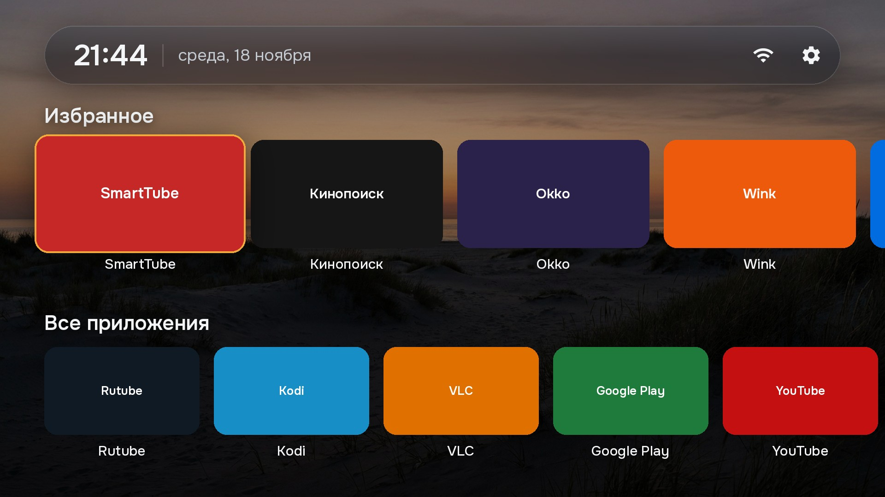
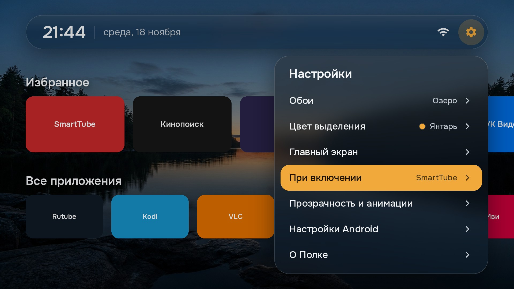
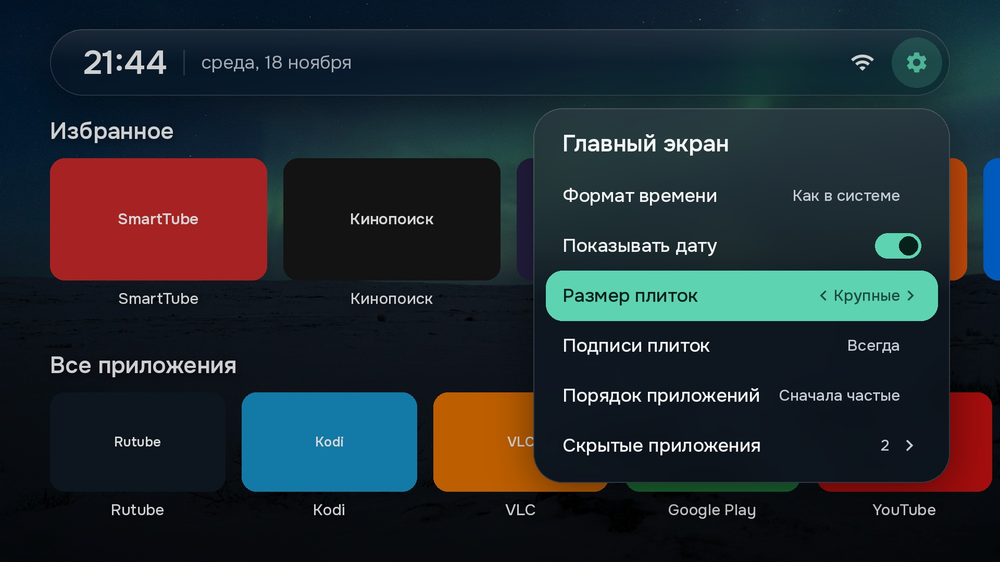

# Полка

Чистый лаунчер для Android TV, сделан под Xiaomi Mi TV Stick 4K на Android TV 14.
Без рекламы, рекомендаций и сетевых запросов: только часы, избранное и все приложения.





Стекло сделано без живого размытия: обои размыты один раз заранее, панель рисует
свой кусок этой копии. На слабом S905Y4 это ноль blur-проходов за кадр.

## Сборка

**GitHub Actions.** Каждый пуш в `main` собирает подписанный APK. Готовый файл лежит
в Releases (`polka-<версия>.apk`) и в артефакте `polka-apk` у запуска. Короткий отчёт
о последней сборке, с ошибками компиляции, если они были, пишется в ветку `ci-status`.

**Android Studio.** Открой папку, дождись синхронизации Gradle, затем
Gradle > app > Tasks > build > `assembleRelease`. APK будет в `app/build/outputs/apk/release/`.

## Установка на стик

```
adb connect 192.168.1.50:5555
adb install -r app-release.apk
adb shell cmd package set-home-activity dev.lucudar.polka/.MainActivity
adb shell pm disable-user --user 0 com.google.android.tvlauncher
```

Последняя строка нужна, чтобы кнопка Home вела только в Полку.

## Вернуть стоковый лаунчер

```
adb shell pm enable com.google.android.tvlauncher
adb shell cmd package set-home-activity com.google.android.tvlauncher/.MainActivity
```

## Управление

- OK: открыть приложение.
- Удержать OK или нажать «Меню»: меню плитки (в избранное, переставить, скрыть, о приложении, удалить).
- «Переставить»: стрелки двигают плитку, OK или «Назад», чтобы закончить.
- Шестерёнка справа вверху: настройки Полки. «Назад» возвращает на шаг, с первой страницы закрывает панель.
- Home на главном экране: закрыть всё и вернуться в начало рядов.

## Настройки

Шестерёнка справа вверху открывает панель Полки, значок Wi-Fi рядом сразу ведёт в настройки сети.
Панель вырастает из шапки, главный экран остаётся виден слева, поэтому всё меняется вживую.
Настройки хранятся на стике и переживают перезапуск.

- **Обои**: Озеро, Дюны, Горы, Сияние и яркость 100, 75 или 50 %. Под каждую картинку
  подобраны скрим и плотность стекла, чтобы заголовки и дата читались даже на светлом небе.
- **Цвет выделения**: Янтарь, Мята, Лёд, Коралл, Лён. Строка в фокусе заливается цветом
  с тёмным текстом, контраст от 8:1.
- **Главный экран**: формат времени (как в системе, 24 или 12 часов), дата, размер плиток
  (компактные, обычные, крупные), подписи под плитками (нет, в фокусе, всегда), порядок
  (по алфавиту, сначала частые, сначала новые), скрытые приложения.
- **При включении**: приложение, которое откроется сразу после включения стика. Срабатывает
  один раз за загрузку, «Домой» возвращает на Полку.
- **Прозрачность и анимации**: «Уменьшить прозрачность» делает стекло сплошным в тон обоев,
  «Без анимаций» оставляет все состояния, но меняет их мгновенно.
- **Настройки Android**: сеть, пульты и Bluetooth, экран, звук, приложения, хранилище,
  заставка, дата и время, все настройки. Если прошивка не знает какой-то экран, откроются
  общие настройки.
- **О Полке**: версия, свободное место, сделать Полку главным экраном, очистить избранное,
  сбросить настройки (оба сброса в два нажатия).

Значения с вариантами листаются OK или стрелками вправо и влево, в фокусе по бокам видны стрелки.
Порядок «Сначала частые» обновляется по кнопке Home, чтобы ряд не перетасовывался под рукой.
Поставили или удалили приложение: ряды обновятся сразу.

## Что внутри

Kotlin и Jetpack Compose (только foundation, без Material), шрифт Onest с нормальной кириллицей.
Ключ подписи лежит в `app/polka.p12` (пароль `polka-launcher`), поэтому обновления
ставятся поверх без удаления. Для публикации замени его своим.
